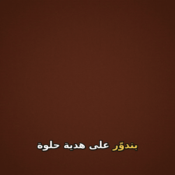

<div dir="rtl">

# ehky · احكي

**بتحوّل أي نص عربي لفيديو قصير، بصوت مصري حقيقي.**
ببلاش، وشغالة على جهازك، ومن غير account ولا API key.

[English](README.md)

<p align="center"></p>

## ليه ehky؟

معظم أدوات تحويل النص لفيديو يا إما بتتكلم فصحى، يا إما محتاجة API key بفلوس، يا إما الـ
subtitles العربي فيها بتبوظ: الحروف بتطلع مفككة، أو الكلام بيتعكس. ehky معمولة للعربي من الأول:

- **صوت مصري:** بتستخدم [VoiceTut-TTS](https://huggingface.co/mohammedaly22/VoiceTut-TTS)، موديل مصري
  مفتوح فيه 19 صوت، وبيشتغل على جهازك. ولو مش متسطّب، بتستخدم أصوات Edge المجانية.
- **Subtitles بتتقري صح:** الحروف متوصّلة، والكلام من اليمين للشمال، والكلمة اللي بتتقال بتنوّر.
- **صوتك أنت لو تحب:** سجّل بصوتك وادّيه بـ `--audio`، والفيديو هيتبني عليه.
- **أمر واحد:** نص يدخل، و`.mp4` يطلع. 9:16 للـ Reels وTikTok، أو 16:9، أو 1:1.

## تبدأ إزاي

محتاج **Python 3.11** أو أحدث، و**ffmpeg** ([من هنا](https://ffmpeg.org/download.html)).

</div>

```bash
pip install git+https://github.com/morgankotb7-eng/ehky
ehky doctor
ehky init my-video --template fact
ehky make my-video
```

<div dir="rtl">

عدّل `my-video/script.txt`. كل سطر بيتقري بنفَس واحد، فحط الجمل اللي مع بعض في نفس السطر،
واكتب زي ما الناس بتتكلم مش زي الإعلانات. وحط صورك أو الكليبات بتاعتك في `my-video/media/`، وشغّل `ehky make`
تاني. لو مفيش صور، ehky بتعمل خلفية متحركة هادية.

## القوالب (templates)

| القالب | المقاس | ينفع لـ |
|--------|--------|---------|
| `fact` | 9:16 | معلومة سريعة للـ Reels وTikTok وShorts |
| `tutorial` | 16:9 | شرح خطوة بخطوة لـ YouTube أو LinkedIn (بالـ subtitles) |
| `ad` | 1:1 | إعلان لمنتج أو محل على Facebook وInstagram |

كل مشروع فيه ملف `ehky.toml` تقدر تغيّر فيه المقاس، والخلفية، والصوت، والـ subtitles. ولو كتبت
اسم setting غلط، هيقولك على طول بدل ما يتجاهله.

## الأوامر

</div>

```
ehky init NAME [--template fact|tutorial|ad]
ehky make SOURCE [options]
ehky voices
ehky doctor [--online]
```

<div dir="rtl">

| الأمر | بيعمل إيه |
|-------|-----------|
| `--subtitles` / `--no-subtitles` | يحط subtitles عربي والكلمة اللي بتتقال منوّرة |
| `--audio FILE` | يستخدم تسجيل بصوتك بدل الموديل |
| `--engine auto\|voicetut\|edge` | `auto` بيستخدم الصوت المصري لو متسطّب، وإلا Edge |
| `--speaker NAME` | صوت من VoiceTut، زي `Tareq` أو `Yasmin` |
| `--voice NAME`، `--rate` | صوت Edge وسرعته |
| `--media DIR` | الصور والكليبات، بترتيب الأسماء، وبينهم fade |
| `--dry-run` | يتأكد من كل حاجة ويوريك الخطة من غير ما يعمل فيديو |
| `--force` | يكتب فوق الفيديو لو موجود |
| `--timeout SECONDS` | يوقف ffmpeg لو طوّل (الافتراضي 1800 ثانية) |

كل المدخلات بتتراجع قبل أي شغل تقيل، فأي غلطة بتبان في ثانية مش بعد دقيقتين render.

## تسطيب الصوت المصري

الصوت المصري بيشتغل على جهازك، ومحتاج PyTorch وOmniVoice (حوالي 2 GB أول مرة). من غيرهم ehky
بتستخدم أصوات Edge أونلاين.

</div>

```bash
pip install torch --index-url https://download.pytorch.org/whl/cpu
pip install git+https://github.com/k2-fsa/OmniVoice.git
pip install voicetut-tts
ehky doctor
```

<div dir="rtl">

على الـ CPU بياخد وقت أطول من الكلام نفسه بكتير (كام دقيقة لفيديو 15 ثانية)، وعلى GPU أسرع بكتير.
الموديل بيتحمّل مرة واحدة بس.

## توقيت الـ subtitles

- **أصوات Edge** بتقول وقت كل كلمة، فالكلمة المنوّرة ماشية مع الصوت بالظبط.
- **VoiceTut** بيتوقّت بالجملة، والكلمات جوه الجملة بتتوزع حسب طولها. قريب، بس مش مظبوط 100%.
- **تسجيلك أنت** النص بيتوزع على طول التسجيل، فالأحسن تقرا بسرعة ثابتة.

## الخصوصية

- VoiceTut و`--audio` شغالين من غير نت بعد التسطيب، والنص بتاعك مبيخرجش من جهازك.
- أصوات Edge بتبعت النص لخدمة Microsoft عشان تحوّله لصوت.
- لو ورا proxy في الشركة، حط مسار شهادة الشركة في `EHKY_CA_BUNDLE` والـ proxy في `HTTPS_PROXY`.
  التحقق من الشهادات بيفضل شغال.

## شكر

- [VoiceTut-TTS](https://github.com/MohammedAly22/VoiceTuT-TTS) لـ Mohammed Aly (Apache-2.0)، الصوت المصري.
- [edge-tts](https://github.com/rany2/edge-tts) للأصوات الأونلاين.
- [FFmpeg](https://ffmpeg.org/) و[libass](https://github.com/libass/libass) للفيديو والـ subtitles.

استخدم الأصوات بمسؤولية: متقلّدش صوت حد حقيقي، ومتعملش تسجيلات مضللة.

## الترخيص

MIT © Mohamed Kotb

</div>
