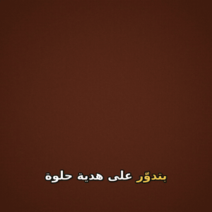

<div align="center">

# ehky · احكي

**Turn Arabic text into a narrated short video, with a real Egyptian voice.**
Free. Runs on your machine. No account, no API key.

[](https://github.com/morgankotb7-eng/ehky/actions/workflows/ci.yml)


[](LICENSE)

[العربي](README.ar.md)



</div>

## Why

Most text-to-video tools speak Modern Standard Arabic, need a paid API key, or break Arabic
subtitles (letters come out disconnected, or the words end up in the wrong order). ehky is built
for Arabic first:

- **Egyptian voice.** Uses [VoiceTut-TTS](https://huggingface.co/mohammedaly22/VoiceTut-TTS), an
  open Egyptian-Arabic model with 19 voices, running locally. Falls back to free Edge voices.
- **Subtitles that read right.** Correct letter shaping and right-to-left word order, with the
  word being spoken highlighted as the voice says it.
- **Your voice, if you prefer.** Record yourself and pass `--audio`; ehky builds the video around it.
- **One command.** Script in, `.mp4` out: 9:16 for Reels/TikTok/Shorts, 16:9, or 1:1.

## Quick start

You need **Python 3.11+** and **ffmpeg** ([download](https://ffmpeg.org/download.html)).
For subtitles, ffmpeg must include libass; `ehky doctor` tells you. On macOS, Homebrew's default
`ffmpeg` does not, so use `brew tap homebrew-ffmpeg/ffmpeg && brew install homebrew-ffmpeg/ffmpeg/ffmpeg`
or a static build that lists libass. Videos without subtitles work with any ffmpeg.

```bash
pip install git+https://github.com/morgankotb7-eng/ehky
ehky doctor                         # checks ffmpeg, fonts and voices
ehky init my-video --template fact  # starter project with an Egyptian script
ehky make my-video                  # -> my-video/video.mp4
```

Edit `my-video/script.txt`: each line is read in one breath, so keep sentences that belong together
on the same line, and write the way people talk. Drop images or clips into `my-video/media/`, and run `ehky make` again.
Without media, ehky uses a calm animated background.

## Templates

| Template   | Format | Good for |
|------------|--------|----------|
| `fact`     | 9:16   | "Did you know" shorts for Reels, TikTok, Shorts |
| `tutorial` | 16:9   | Step-by-step how-tos for YouTube or LinkedIn (subtitles on) |
| `ad`       | 1:1    | A product or shop promo for Facebook and Instagram |

Each project has a `ehky.toml` you can edit:

```toml
aspect = "9:16"       # 9:16, 16:9 or 1:1
theme = "charcoal"    # background without media: charcoal, sand, forest, ember
engine = "auto"       # auto, voicetut or edge
speaker = "Tareq"     # VoiceTut voice
voice = "ar-EG-ShakirNeural"  # Edge voice
rate = "+0%"          # Edge speaking speed
subtitles = false
output = "video.mp4"
```

Unknown keys or wrong types fail with a clear message instead of being ignored.

## Command reference

```
ehky init NAME [--template fact|tutorial|ad]
ehky make SOURCE [options]     # SOURCE is a project folder or a .txt file
ehky voices                    # list voices
ehky doctor [--online]         # check the setup
```

| Option | What it does |
|--------|--------------|
| `--subtitles` / `--no-subtitles` | Burn in Arabic subtitles with the current word highlighted |
| `--audio FILE` | Use your own recording (wav, mp3, m4a, ogg, flac) instead of a model |
| `--engine auto\|voicetut\|edge` | `auto` uses the Egyptian voice when installed, else Edge |
| `--speaker NAME` | VoiceTut voice, e.g. `Tareq`, `Yasmin` (see `ehky voices`) |
| `--voice NAME`, `--rate` | Edge voice and speed, e.g. `ar-EG-SalmaNeural`, `-10%` |
| `--media DIR` | Images/clips to use, in name order, with crossfades |
| `--aspect`, `--theme` | Override the project settings |
| `--dry-run` | Check every input and print the plan, generate nothing |
| `--force` | Overwrite an existing output file |
| `--timeout SECONDS` | Stop ffmpeg after this long (default 1800) |

All inputs are checked before any slow work starts, so a typo fails in a second, not after a
two-minute render.

## Egyptian voice setup

The Egyptian voice runs on your computer and needs PyTorch and the OmniVoice backbone
(about 2 GB of downloads the first time). Without it, ehky uses the online Edge voices.

```bash
pip install torch --index-url https://download.pytorch.org/whl/cpu
pip install git+https://github.com/k2-fsa/OmniVoice.git
pip install voicetut-tts
ehky doctor    # should show: [ok] Egyptian voice (voicetut)
```

On a CPU it takes several times longer than the speech itself (a few minutes for a 15-second
video); a GPU is much faster. The model downloads once and is cached.

## How subtitles are timed

- **Edge voices** report the time of every word, so the highlight follows the voice exactly.
- **VoiceTut** is timed per sentence, and words inside a sentence are spread by length. It is
  close, not perfect.
- **Your own recording** is timed by spreading the script over the recording, so subtitles work
  best when you read the script at an even pace.

## Network and privacy

- VoiceTut and `--audio` work fully offline after setup. Your script never leaves your machine.
- Edge voices send the script text to Microsoft's speech service to synthesize it.
- Behind a company proxy that re-signs HTTPS, set `EHKY_CA_BUNDLE` to your company's CA file and
  `HTTPS_PROXY` to the proxy. Certificate checks stay on.

## Development

```bash
git clone https://github.com/morgankotb7-eng/ehky && cd ehky
pip install -e . ruff
python -m unittest discover -s tests
ruff check . && ruff format --check .
```

CI runs the tests and renders a real video on Linux, Windows and macOS with Python 3.11 to 3.13.
See [CONTRIBUTING.md](CONTRIBUTING.md).

## Credits

- [VoiceTut-TTS](https://github.com/MohammedAly22/VoiceTuT-TTS) by Mohammed Aly (Apache-2.0), the Egyptian voice.
- [edge-tts](https://github.com/rany2/edge-tts) for the online voices.
- [FFmpeg](https://ffmpeg.org/) and [libass](https://github.com/libass/libass) for video and subtitles.

Please use voices responsibly: do not imitate real people or make misleading audio.

## License

MIT © Mohamed Kotb
